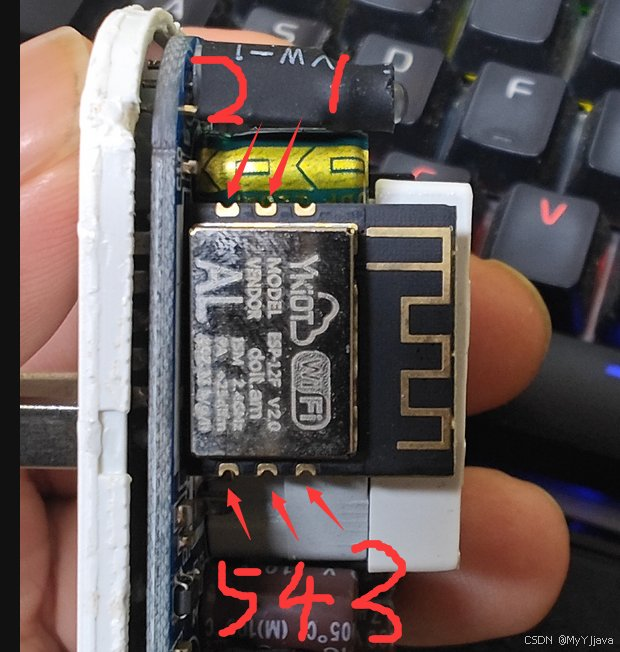
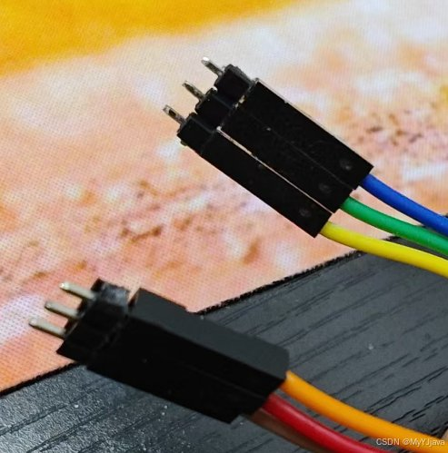

# YKYC-001 刷机说明（云控智能固件）

固件来源：MyYJjava/yun_kong（Gitee）。源码从该仓库 git 历史中找回（仓库现行目录只剩 bin，源码在历史提交里），本地用 arduino-cli + ESP8266 core 3.1.2 + BGWiFiConfig 1.1.1 + PubSubClient 编译验证。

## 文件

| 文件 | 说明 |
|---|---|
| ykyc001_v2_compiled.bin | **推荐**。最新版源码（661 行，含延时修复、启动超时修复、本地状态页）本地编译，462,896 B |
| ykyc001_v2_custom_mqtt.bin | **推荐**。增强版：支持 OneNET AIoT (TLS 8883) + 自建局域网 MQTT，477,584 B |
| ykyc001_v2_author.bin | 作者发布的 v2 原版 bin，462,912 B（与本地编译版仅差 16 B 构建信息，字符串全等） |
| ykyc001_v1_compiled.bin | CSDN 源码篇版本（381 行）本地编译，457,520 B |
| ykyc001_v1_author.bin | 作者 v1 原版 bin，477,776 B |
| 12F_v2.ino / 12F_v1.ino | 对应源码 |

刷哪个都行：v2_compiled 与作者 v2 等价；不放心自编译就刷 v2_author。

## 拆机

壳无螺丝、合缝有胶：热吹风沿缝加热吹软胶 → 刀片撬开一条缝 → 除胶液滴入缝内静置约 1 小时 → 钳子夹住一条插头脚平直拔出，壳即开。全程断电，除胶液别滴到板上（详见 README「拆机」节）。

## ⚠️ 刷之前先备份原厂固件（文章里没人提这步）

接好串口后，先整片读出来存底，万一想回原厂就靠它：

```
esptool.py --port COMx read_flash 0x0 0x100000 ykyc001_stock_backup.bin
```

## 接线（模块刷写焊盘，断电状态下接，全程禁止插市电）



| 焊盘 | 功能 | 接 CH340G 模块 |
|---|---|---|
| 1 | VCC 3.3V | 3V3 |
| 2 | GND | GND |
| 3 | TX（模组发送） | RXD |
| 4 | RX（模组接收） | TXD |
| 5 | 进刷写模式（GPIO0） | 接 GND（可与 2 号共地线） |

要点：串口 TX/RX 交叉接（模组 TX 接模块 RXD）；5 号只需在上电/复位瞬间接地，进下载模式后可松开；供电只用 CH340G 的 3.3V 且须能供 ≥300mA（ESP8266 发射峰值），**绝不接 5V、绝不插市电**。

作者的免焊做法：自制探针夹具（2 针 + 3 针排针带杜邦线），正对模组上下两排焊盘按住即可刷，不用烙铁：




## 刷入（应用 bin，写 0x00000）

```
esptool.py --port COMx --baud 460800 write_flash --flash_mode dout --flash_freq 40m --flash_size 1MB 0x00000 ykyc001_v2_compiled.bin
```

刷完断开 5 脚对 GND 的短接，重新上电（仍用 3.3V 先验证，别急着装壳上市电）。

## 首次配网

> 本节按原版 bin（连作者 OneNET + 小程序）写；刷增强版 `ykyc001_v2_custom_mqtt.bin` 的配网字段与模式选择见 `custom-mqtt/README.md`（OneNET AIoT 或自建 MQTT 二选一，服务器栏只填裸 IP、勿带 `mqtt://` 前缀）。

1. 上电后灯闪烁 = 未联网。手机连名为「WiFi配网」的热点（关掉手机的 WLAN 智能切换，提示无互联网选保持连接）
2. 浏览器打开 192.168.22.1，填：家里 WiFi（必须 2.4G、WPA2）名称+密码；设备 ID = 微信小程序里「复制 ID」；加密串 = 「复制参数」；mode 选 1
3. 提交后热点消失、灯变常亮（蓝=通电开，红=断电关）即上线，小程序里应显示在线
4. 填错：长按按键 10 秒清配网，断电重启重来

## 注意

- 这是 250V 市电设备：串口连接期间绝对不能插市电；装回外壳确认绝缘完好后再上墙电。
- 固件连的是作者的 OneNET 产品（538578）和他的微信小程序，后台可用性取决于作者，与本地编译无关。
