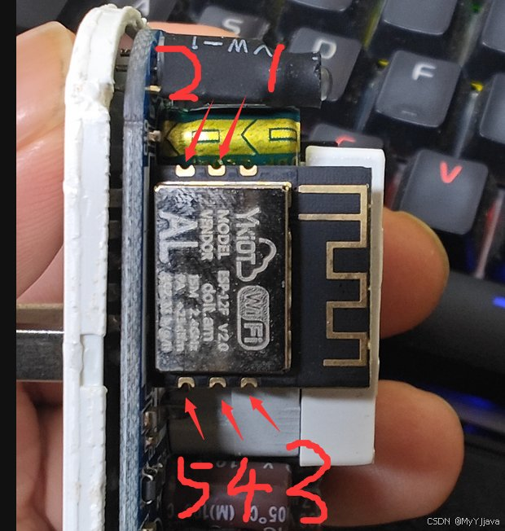

# yunkong — 浙江云控 YKYC-001 智能插座复活固件

阿里智能停服后，YKYC-001（ESP-12F / ESP8266）智能插座的自写固件存档与增强：

- **原版路线**：连中国移动 OneNET，用作者的微信小程序远程控制（作者托管后台）
- **本仓增强（推荐）**：支持中国移动 OneNET AIoT (TLS 8883) 物联网融合平台与自定义局域网 MQTT 双模式，用官方 OneJson 物模型或自建 broker 控制，并支持**设备本地定点时刻表**，彻底脱离原作者后台

固件原作者：MyYJjava（Gitee: `jjiangajava/yun_kong`，CSDN 教程《阿里智能YKYC-001智能插座，残血复活》《运控智能插座不能用了，自己写代码解决》）。上游仓库现行目录已删除源码，本仓库的源码从其 git 历史中找回，并按作者配置复现编译、与作者发布的 bin 校验等价；增强版为本仓在其最新版源码基础上的增量改动（OneNET 路径已升级为最新的 AIoT 物联网融合平台）。

## 刷哪个 bin

| 文件 | 适合 |
|---|---|
| `bin/ykyc001_v2_custom_mqtt.bin` | **推荐**。477,504 B，sha256 `d1ce7282f5266042455a487a532e9005ae66375a335f7d86f2722956ed9be323`。支持 OneNET AIoT 物联网融合平台（TLS 8883 加密连接，OneJson 物模型，双向同步按键与云端状态，可在配网页输入 Token，不泄露任何私钥）；配网填 MQTT 服务器则无缝切自有 broker（自建 MQTT），双模式均支持本地时刻表 |
| `bin/ykyc001_v2_compiled.bin` | 原版最新源码的复现编译，462,896 B（与作者 v2 bin 仅差 16 B 构建信息） |
| `bin/author/ykyc001_v2_author.bin` | 作者发布的 v2 原版，462,912 B |
| `bin/ykyc001_v1_compiled.bin` / `bin/author/ykyc001_v1_author.bin` | 第一版（CSDN 源码篇版本），存档 |

刷法统一：整 bin 写 `0x00000`，见 `FLASHING.md`（含刷前整片备份原厂这一步，别省）。

## 增强版固件特性（OneNET AIoT & 自定义 MQTT）

详见 [`custom-mqtt/README.md`](custom-mqtt/README.md)。

- **双模式自由切换**：
  - **OneNET AIoT 模式（默认）**：支持 TLS 8883 (MQTTS) 安全加密直连中国移动 OneNET AIoT 物联网融合平台（`MiXfbNnY6r.mqttstls.acc.cmcconenet.cn:8883`），内置官方公开根证书，采用标准 OneJson 物模型（`switch1` / `total_switch`），支持云端控制与物理按键双向状态实时同步。配网页留空 MQTT 服务器即默认走此路径。
  - **自定义 MQTT 模式**：配网页填入自建 broker 地址（如 CasaOS Mosquitto），直连局域网，用任意 MQTT 客户端（Home Assistant、mqtt-panel 等）控制。
- **本地定点时刻表（两模式通用）**：本地最多 4 条规则，到点动作，断网照常执行；文本形如 `0730,1,127;1730,0,127`（每天 07:30 开、17:30 关），经局域网维护页表单或 MQTT 主题 `yunkong/<id>/schedule/set` 配置，规则存 EEPROM、SNTP 对时（默认 UTC+8）。
- **自定义 MQTT 协议要点**：控制 `yunkong/<id>/set`（`ON`/`OFF`），状态 `yunkong/<id>/state`（retained），在线 `yunkong/<id>/online`（retained + LWT）。

### 在本地终端计算 OneNET Token（安全防泄露）

由于本仓库是公开的，**严禁在代码、文档或固件中硬编码私有 AccessKey**。用户可在本地终端使用仓库自带的 CLI 工具安全计算 10 年免维护 Token，仅将生成的 Token 填入设备配网页（主密钥 AccessKey 绝不上板，保障账户安全）：

```bash
# 1. 设备级 Token（推荐，仅授权特定设备，例如 ykyc001_dev1）
python tools/onenet_tool.py token --pid MiXfbNnY6r --dev ykyc001_dev1 --key <你的AccessKey>

# 2. 或产品级 Token（该产品下所有插座设备共用，适合批量配网）
python tools/onenet_tool.py token --pid MiXfbNnY6r --key <你的AccessKey>

# 3. 也可以通过环境变量传入密钥（避免在终端历史记录留下明文）
export ONENET_ACCESS_KEY="<你的AccessKey>"
python tools/onenet_tool.py token --dev ykyc001_dev1
```

运行后会输出以 `version=2018-10-31&...` 开头的 Token 字符串。设备刷机后连接其热点（访问 `http://192.168.22.1`），在配网页的「OneNET Token」一栏粘贴此字符串，设备名称填 `ykyc001_dev1`，其余服务器、端口留空即可自动连通 OneNET。

## 目录

| 路径 | 说明 |
|---|---|
| `12F/12F.ino` | 原版最新固件源码（661 行）：延时修复、启动超时修复、本地状态页 |
| `custom-mqtt/` | 增强版（OneNET AIoT TLS + 自建 MQTT）：源码、物模型、时刻表与单测 |
| `docs/onenet_http_api.md` | OneNET AIoT RESTful HTTP API 使用指南（添加设备、云端控制等） |
| `tools/` | OneNET AIoT 本地安全工具：Token 计算、设备创建/查询与仿真联调 |
| `legacy/12F_v1.ino` | 第一版源码（381 行），即 CSDN 源码篇发布版 |
| `legacy/12F_ESP01.ino` | ESP-01 变体源码（602 行，参考） |
| `bin/` | 各版本编译产物与作者原版 bin（见上表） |
| `FLASHING.md` | 刷机说明：备份原厂、接线、刷入、配网 |

## 硬件要点

- 模块：ESP-12F V2.0；引脚：蓝灯 GPIO12、红灯 GPIO16、继电器 GPIO14、按钮 GPIO13
- 刷写焊盘 1–5：VCC 3.3V / GND / TX / RX / 接 GND 进刷写模式
- 原版后台：OneNET MQTTS `mqttstls.heclouds.com:8883`，产品 ID `538578`（作者托管，服务端源码未公开）

## 拆机（实测方法，2026-11-01）

外壳无螺丝、合缝有胶，干撬易裂。实测有效的开法：

1. 热吹风机沿合缝均匀加热，把胶吹软
2. 用刀片沿缝撬开一条口子（刀口朝外，别往电路板和市电铜箔方向使劲）
3. 除胶液沿缝滴入，静置约 1 小时等它渗透化胶
4. 用钳子夹住一条插头脚（市电插脚）平直往外拔，整个壳体随之打开

全程断电操作；除胶液只入壳缝，不要滴到电路板上。

## 刷机接线



| 焊盘 | 功能 | 接 CH340G 模块 |
|---|---|---|
| 1 | VCC 3.3V | 3V3 |
| 2 | GND | GND |
| 3 | TX（模组发送） | RXD |
| 4 | RX（模组接收） | TXD |
| 5 | 进刷写模式（GPIO0） | 接 GND（可与 2 号共地线） |

要点：串口 TX/RX 交叉接（模组 TX 接模块 RXD）；5 号只需在上电/复位瞬间接地，进下载模式后可松开；供电只用 CH340G 的 3.3V，**绝不接 5V、绝不插市电**。

免焊提示：作者自制了 2 针 + 3 针探针夹具按住焊盘刷机（图在 `FLASHING.md`），不想焊接的可以仿制。

刷机步骤（先备份原厂再写 bin）见 `FLASHING.md`。实物图来源：原作者 MyYJjava 的 CSDN 教程《阿里智能YKYC-001智能插座，残血复活》，图上编号即作者标注。

## 编译

- WSL / Linux 环境下安装 `arduino-cli` + ESP8266 core 3.1.2
- 依赖库：BGWiFiConfig 1.1.1（fish-five）、PubSubClient 2.8
- 板型配置（作者 arduino.json 原样）：`esp8266:esp8266:generic`，xtal=80、CrystalFreq=26、FlashFreq=40、FlashMode=dout、eesz=1M64、ssl=basic、mmu=3232、non32xfer=fast、ResetMethod=nodemcu、sdk=nonosdk_190703、ip=lm2f、led=2、vt=flash、exception=disabled、stacksmash=disabled

```bash
# WSL 下编译增强版（支持 OneNET AIoT 与 自定义 MQTT）：
arduino-cli compile --output-dir ./bin -b 'esp8266:esp8266:generic:xtal=80,vt=flash,exception=disabled,stacksmash=disabled,ssl=basic,mmu=3232,non32xfer=fast,ResetMethod=nodemcu,CrystalFreq=26,FlashFreq=40,FlashMode=dout,eesz=1M64,led=2,sdk=nonosdk_190703,ip=lm2f,dbg=Disabled,lvl=None____,wipe=none,baud=115200' custom-mqtt/12F
```

校验：自编原版 v2（462,896 B）与作者 v2 bin（462,912 B）仅差 16 B 构建信息，可读字符串全等。自定义版与 OneNET AIoT 版的纯逻辑（载荷解析、topic 构造、时刻表解析/触发）有主机侧测试（`custom-mqtt/test/`，g++ 可直接跑），全绿且通过变异探针；编译自有文件零警告。

## 配网

上电灯闪 → 手机连「配网」热点 → 浏览器 192.168.22.1：

- **OneNET AIoT 模式（默认）**：填家里 2.4G WiFi、设备名（`ykyc001_dev1`）、本地生成的 OneNET Token，其余留空
- **自定义 MQTT 模式**：填家里 2.4G WiFi、设备名，并填入 MQTT 服务器 IP 等字段

长按按键 10 秒清配网重来。

⚠️ **验证状态：以上固件均已通过 WSL 编译（无警告）与主机侧逻辑单测。** 250V 市电设备：串口刷机全程禁止插市电，只用隔离 3.3V 供电；刷前先 `read_flash` 整片备份原厂固件（见 FLASHING.md）。
